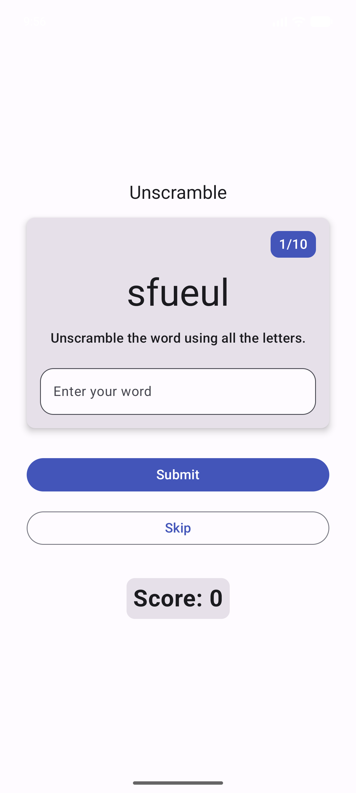

# Unscramble: ViewModel y State en Compose

Proyecto de la tarea de codelab a elección. Incluye el juego terminado, una explicación del trabajo y una captura real de la app funcionando en el emulador.

Codelab: [ViewModel y State en Compose](https://developer.android.com/codelabs/basic-android-kotlin-compose-viewmodel-and-state?hl=es-419).

Repositorio: [Higan-Banana/unscramble-codelab](https://github.com/Higan-Banana/unscramble-codelab).

## Qué hace la app

Es un juego para ordenar palabras en inglés. Cada partida tiene 10 palabras, sin repetir. Una respuesta correcta suma 20 puntos. Si la respuesta está mal, aparece un aviso y se puede intentar de nuevo. También se puede saltar una palabra sin ganar puntos. Al terminar, aparece el puntaje y las opciones de volver a jugar o salir.

## Cambios por etapas

Se trabajó desde la rama `starter`, que al inicio tenía la pantalla lista, pero mostraba una palabra fija y los botones no hacían nada.

1. **Revisión del proyecto:** se revisaron la rama, los archivos y las herramientas de compilación.
2. **Estado del juego:** se agregó `GameUiState` para reunir la palabra, el puntaje, el contador y los avisos del juego.
3. **ViewModel:** se agregó `GameViewModel` para elegir y mezclar palabras. Guarda las palabras usadas para evitar que se repitan.
4. **Conexión con Compose:** la pantalla lee `StateFlow` y muestra sus cambios. El texto del jugador se guarda en el ViewModel.
5. **Respuestas y puntos:** el botón Submit y la tecla Done revisan la respuesta. Se aceptan mayúsculas y minúsculas. Una respuesta incorrecta muestra un error.
6. **Contador y Skip:** acertar o saltar lleva a la siguiente palabra. Saltar no cambia el puntaje.
7. **Fin de partida:** después de la palabra 10 aparece el diálogo final. Volver a jugar limpia los puntos, el contador, el texto y las palabras usadas.
8. **Rotación:** se comprobó en el emulador que se conservan la palabra, el contador, el puntaje y el texto escrito. En horizontal se puede deslizar para ver el contenido de abajo. Esto no guarda la partida si Android cierra el proceso de la app.

Los commits separan estos avances. La dependencia de ViewModel usa la versión 2.8.7 para coincidir con Lifecycle en este proyecto.

## Mi explicación del trabajo

Para esta tarea trabajé el codelab de ViewModel y State en Compose con el juego Unscramble. Partí de la rama `starter`, donde ya estaba el diseño de la pantalla, pero faltaba hacer que el juego funcionara. El trabajo fue conectar esa pantalla con las respuestas, los puntos y el cambio de palabras.

La idea principal es separar lo que se ve de las reglas del juego. `GameUiState` reúne los datos que se muestran, como la palabra, el puntaje y el contador. `GameViewModel` se encarga de cambiarlos cuando se juega. Por ejemplo, al tocar Submit, la pantalla le pasa la respuesta al ViewModel. Si está bien, suma 20 puntos y prepara otra palabra; si está mal, muestra un aviso para intentar de nuevo. Compose lee esos cambios y actualiza la pantalla.

También se agregó la opción de saltar palabras, el límite de 10 palabras por partida y el mensaje final para volver a jugar o salir. Al girar el emulador, la partida conserva la palabra, los puntos y lo que estaba escrito, porque esos datos están guardados en el ViewModel.

Un problema que apareció fue la configuración para compilar. Al principio solo estaba Java 8 y faltaba el SDK de Android. Después instalé Android Studio y, con ayuda de Codex, se configuraron el SDK 35 y un JDK 21 para este proyecto. Con eso se pudo compilar e instalar la app en el emulador Pixel 9 Pro.

Usé Codex como apoyo para revisar el proyecto, implementar los pasos del codelab, resolver la configuración, preparar pruebas y redactar esta explicación. Las comprobaciones automáticas y las pruebas de la app en el emulador también se hicieron con su ayuda. Pasaron las cinco pruebas de la lógica y se comprobó que funcionan las respuestas, los puntos, Skip, la rotación y el reinicio. La captura incluida abajo corresponde a esa ejecución real.

## Problemas del entorno

Al inicio solo estaba disponible Java 8, sin `JAVA_HOME` ni Android SDK configurados. Se descargó un JDK 21 local y se prepararon Android SDK 35 y Build Tools 35.0.0. Gradle 8.12 se ejecutó con ese JDK.

La extracción inicial de las herramientas de Android falló por una ruta demasiado larga en Windows. Primero se usó una carpeta temporal más corta. Después de instalar Android Studio, se actualizó `local.properties` para usar el SDK de `%LOCALAPPDATA%\Android\Sdk`, y se agregaron Platform 35 y Build Tools 35.0.0.

Android Studio trae Java 25. Para este proyecto se comprobó la compilación con el JDK 21 local. En Settings > Build, Execution, Deployment > Build Tools > Gradle, selecciona ese JDK en Gradle JDK (carpeta `.tools/java/jdk-21.0.13.0.2+1` dentro del proyecto).

El código inicial también traía un diccionario distinto en `src/test`, con los mismos nombres que el diccionario de la app. Se reemplazó por pruebas que resuelven las palabras usando el diccionario real.

## Cómo compilar y probar

En Android Studio, abre este proyecto, selecciona un JDK 17 o 21 para Gradle e instala Android SDK Platform 35 y Build Tools 35.0.0. Sincroniza el proyecto y ejecuta el módulo `app` en un emulador o teléfono con Android 7.0 o superior.

Desde PowerShell, con Java y el SDK ya configurados:

```powershell
.\gradlew.bat :app:assembleDebug :app:testDebugUnitTest :app:lintDebug --console=plain
```

Si usas el JDK que se descargó en esta sesión, configura primero la terminal:

```powershell
$env:JAVA_HOME = (Get-ChildItem .tools/java -Directory | Select-Object -First 1).FullName
```

`local.properties` guarda la ruta del SDK de esta máquina. Ese archivo, las herramientas locales y los archivos temporales están fuera de Git.

## Verificaciones realizadas

- Java y Gradle: JDK 21.0.13.0.2 y Gradle 8.12 comprobados.
- SDK: Platform 35, Build Tools 35.0.0 y platform-tools instalados.
- Compilación: `:app:assembleDebug` terminó con `BUILD SUCCESSFUL`. APK generado en `app/build/outputs/apk/debug/app-debug.apk`.
- Pruebas: `:app:testDebugUnitTest` terminó correctamente. Pasaron las 5 pruebas, sin errores ni pruebas omitidas. Reporte local: `app/build/reports/tests/testDebugUnitTest/index.html`.
- Revisión de Android: `:app:lintDebug` terminó correctamente, con 0 errores y 6 avisos. Los avisos son sobre versiones más nuevas de librerías y una etiqueta repetida en el manifiesto. Reporte local: `app/build/reports/lint-results-debug.html`.
- Emulador: Pixel 9 Pro con Android 17, detectado como `emulator-5554`. `:app:installDebug` terminó con `BUILD SUCCESSFUL` y la app abrió correctamente.
- Pantalla: se comprobaron una respuesta incorrecta, un acierto de 20 puntos, Skip sin sumar, rotación con texto escrito, final en 10 palabras y Play Again. La captura de abajo salió de esa ejecución real.

Las pruebas cubren el inicio, las respuestas incorrectas, los puntos, los saltos, las 10 rondas sin repetir, el bloqueo después del final y el reinicio. No reemplazan una prueba de la pantalla en Android.

Resultados obtenidos el 16 de noviembre de 2026. La compilación también mostró avisos sobre herramientas del SDK de distinta generación, `statusBarColor` en el tema original y una biblioteca nativa que se empaquetó sin quitar símbolos. No impidieron generar el APK.

## Pruebas en el emulador

- [x] Escribir una respuesta incorrecta y comprobar el aviso.
- [x] Acertar y comprobar que suma 20 puntos y avanza el contador.
- [x] Usar Skip y comprobar que no suma puntos.
- [x] Rotar el dispositivo y comprobar que siguen la misma palabra, contador, puntaje y texto.
- [x] Llegar a la palabra 10, revisar el puntaje y probar Play Again.
- [x] Terminar otra partida y comprobar Exit.

## Captura real

Unscramble funcionando en el emulador Pixel 9 Pro, después de reiniciar la partida:



## Antes de entregar

- [x] Incluir la explicación del trabajo y del apoyo de IA.
- [x] Ejecutar la app y comprobar la rotación en el emulador.
- [x] Agregar una captura real.
- [x] Probar Exit y revisar el juego por tu cuenta.
- [x] Subir los commits al repositorio propio en GitHub. `origin` apunta al repo de la tarea y `upstream` conserva el enlace al proyecto de Google.
- [x] Dejar el repositorio público para que el equipo del curso pueda revisarlo.
- [x] Revisar el enlace en una ventana de incógnito y publicarlo en Canvas.

## Créditos

Proyecto base de [Google Developer Training](https://github.com/google-developer-training/basic-android-kotlin-compose-training-unscramble), con licencia Apache 2.0. Se conserva el archivo `LICENSE` y los avisos del código original.
